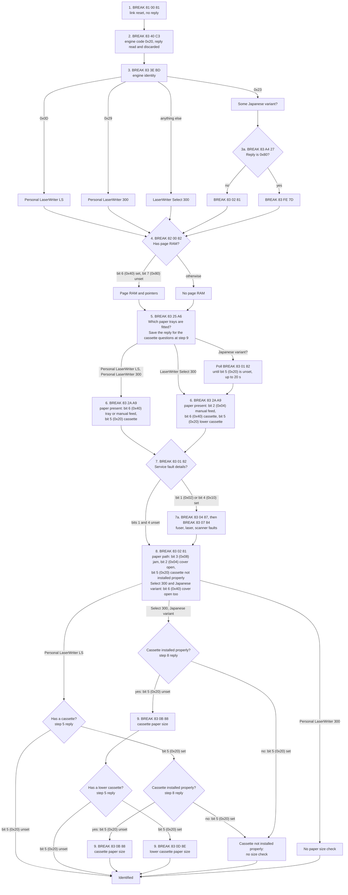

# Reverse Engineering the Personal LaserWriter 300 / LaserWriter Select 300 Driver

Write up of my learnings from decompiling the official Apple driver for these printers, and how to control them from modern machines.

From what I can tell of these drivers these printers are incredibly simple in that virtually all formatting and control is done from the host. The onboard logic requires the host to write to the printers RAM the current page to be printed, signal the page is ready and the printer then begins printing exactly what was handed to it with no real interpretation.

It can be thought of to be _kinda_ like the StyleWriter, but far more primitive in that the host is entirely in control (so the host is entirely in charge of not overrunning RAM), 

The rough flow for driving it is:

- Switch the interface (on the host) to being externally clocked via HSKi. I am _pretty_ sure at this point there is no way around this, and the printer uses this to clock data in and out of its interface.
- Send the link reset sequence and query the current status of the printer, and its engine/controller type. 
- Check the current paper size, any errors, and presence of errors.
- Probe the size of the onboard RAM to know what features we can use (The Select 300 has a SIMM slot, the PLW 300 does not)
- Feed page data to it one page at a time, as one "packet" per scan line with the same RLE as a StyleWriter.
- After the current page has been fed in to RAM, send the print sequence
- Wait for the printer to signal it has finished that page and begin the next, if applicable.

## Data link

Clocked via the printer via HSKi, one bit per clock edge. Every "packet" to the printer starts with a "BREAK" 
sequence, which is a logic 0 sent for a short period of time. This is _fuzzy_ how lon it precisely takes on the Mac, but a few dozen microseconds should be sufficient. I assume this is for the onboard logic to "ready" for a command from us.

After the BREAK, the format then is a 2 byte command code, args for the command, and the XOR of those bytes:
```
BREAK  cmd  arg  cmd^arg
``` 

Depending on the command the printer may send up to 1 byte back as a response, with the original driver allowing up
to 5 seconds for these before timing out.

If the response is 0x81 - 0xFF this should be considered an error with a request to immediately retry the command. The
original driver retries up to 5 times before giving up.

The printer can also send a BREAK sequence towards us, which is its way of signaliIng a sort of interrupt towards the 
host, where the host should then send 0x83 0x00 towards it to read the status register. 

## Probe Sequence

The below sequence is what the original Apple driver sends when it brings up the printer link and tries to discover what is attached to it. Note that I am very much guessing on what each "engine identity" resolves to based on how the original driver later handles them (Like the Select has multiple tray feeds, the one on the end has special B4 paper handling so I think it was some Japanese model, and such)



Notes:

- Bit 5 (0x20) on the response for command `83 25` reply means different things by printer. On
  the Personal LaserWriter LS it means the cassette (without it the printer has
  the multipurpose tray only), on the Select 300 and the Japanese variant it
  is the lower cassette.
- The driver checks paper size only for the cassette feeds. I dont believe there is a way to check
  the multipurpose cassettes (or at least I didnt see any).

## Engine status (`83 01`, `83 02`, `83 04`, `83 07`)

| Query | Bit | Meaning |
|---|---|---|
| `83 01` (all printers) | bit 1 (0x02) or bit 4 (0x10) | a fault is waiting to be read: send `83 04` and `83 07` to find which |
| | bit 4 (0x10) | if `83 04` and `83 07` show no fault, acknowledge with `83 5D` (inferred: "something to report") |
| | bit 5 (0x20) | Not ready yet(Japanese variant only). Driver waits up to 20 s for it to clear before checking for paper |
| `83 02` | bit 3 (0x08) | paper jam |
| | bit 2 (0x04) | front open, or toner cartridge not properly installed |
| | bit 5 (0x20) | cassette not installed properly |
| | bit 6 (0x40) | front open (Select 300 and Japanese variant only) |
| `83 04` | bit 6 (0x40) | fuser malfunction |
| | bit 5 (0x20) | laser malfunction |
| | bit 4 (0x10) | scanner motor malfunction |
| | bit 2 (0x04) | scanner motor malfunction (Japanese variant only) |
| `83 07` | bit 6 (0x40) | laser malfunction |
| | bit 3 (0x08) | cassette paper smaller than the page |
