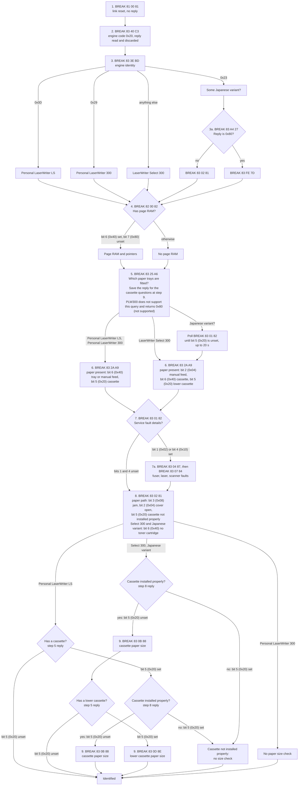

# Reverse Engineering the Personal LaserWriter 300 / LaserWriter Select 300 Driver

Write up of my learnings from decompiling the official Apple driver for these printers, and how to control them from modern machines.

From what I can tell of these drivers these printers are incredibly simple in that virtually all formatting and control is done from the host. The onboard logic requires the host to write to the printer's RAM the current page to be printed, signal the page is ready and the printer then begins printing exactly what was handed to it with no real interpretation.

It can be thought of to be _kinda_ like the StyleWriter, but far more primitive in that the host is entirely in control and must fill in the onboard RAM and tell the printer when exactly to print.

The rough flow for driving it is:

- Switch the interface (on the host) to being externally clocked via HSKi. This is the only way
  to communicate with the printer, with my Personal 300 clocking it at roughly 530kHz.
- Send the link reset sequence and query the current status of the printer, and its engine/controller type. 
- Check for paper presence, and any errors that might be set (The Apple driver does not check for errors before printing attempts, but we can do better)
- If page RAM is reported (As on the Select 300 and LS models), probe the RAM to see how much is present. 
- Feed page data to it one page at a time, as one "packet" per scan line with the same RLE as a StyleWriter.
- After the current page has been fed in to RAM, send the print sequence
- Wait for the printer to signal it has finished that page and begin the next, if applicable.

## Data link

The printer constantly drives the HSKi line as long as it is powered up. This can be used to 
detect if the printer is currently connected and powered on. I have yet to find a case where
this clock stops.

The data link itself is clocked by the printer via HSKi as 8N1, LSB first. Transmits towards
the printer should be changed on the falling edge of this clock, and receives from the printer
should be sampled by us on the rising edge.

Every "packet" to the printer starts with a "BREAK" sequence, which is a logic 0 sent for a short period of time.  I assume this is for the onboard logic to "ready" for a command from us. When sampled with my Saleae my PowerBook G3 took approx 180uS, but I am not sure what the true minimum is required here. 

The Mac left a minimum of 210uS from the BREAK to the first bytes and 310uS between packets.

After the BREAK, the format then is a 1 byte command code, 1 arg byte for the command, and the XOR of those two bytes:
```
BREAK  cmd  arg  cmd^arg
``` 

The printer generally returns 1 byte from each command, with the notable exception being 0x8E -
if the printer responds with 0x00 and the printer does _not_ have page RAM, an additional
byte should be expected which contains the status byte.

The driver waits up to 5 seconds for a response to these before timing out. Note that for some commands like 0x82 I noticed the
printer would start answering us whilst we are still transmitting the XOR byte, and for others like 0x83 it would take approx 30ms to respond.

Replies to 0x83 commands can also reject the command or ask for it to be sent again, see 0x83 below.

The printer can also send a BREAK sequence towards us, which is its way of signalling a sort of interrupt towards the 
host, where the host should then send 0x8E 0x00 towards it to read the status register. 

## Commands 

### 0x81 (0x00) - Reset - No Reply

First command that should be issued when starting a fresh job with the printer or opening a fresh link. This command appears to reset the data RAM pointers back to their start positions in memory.

It does not appear to reset anything in the printer's RAM, as the original driver sends this between multi-copy prints (i.e send job to RAM once and print X copies of it). Just likely prepares it for a new print.

### 0x82 0x00 - Controller Status - 1 byte response

| Bit | Meaning | 
|---|---|
| 7 | Controller Type |
| 6 | Controller Type |
| 5 | Unknown |
| 4 | Unknown |
| 3 | Unknown - Driver seems to clear the ready bit in 0x84 reg when it is set (/RDY line?) | 
| 2 | Unknown |
| 1 | Unknown |
| 0 | RAM full |

The controller type values (bits 7 and 6, in binary) correspond to:

- `00` - No page RAM pointers
- `01` - Page RAM with pointers
- `10` - No page RAM pointers (PLW300 uses this type)
- `11` - No page RAM pointers

### 0x83 (Arg) - Engine Command and Status

This command has a number of different sub-args and are broken up below. For all of the below commands, bit 7 means the printer did not accept the command. If only bit 7 is set, it means the printer does not support this command code. If bit 7 is set and any other bit is also set then it means the command should be sent again to the printer. The original driver tries up to 5 attempts in total.

In every reply, bit 0 is an odd parity bit and can be ignored.

For "Unused by the driver" values, these are ones the original Apple drivers ignore. I don't know
if these mean anything special, but they don't seem important at least.

For args below that take an input (0x58, 0x5B, 0x9D and 0xA7), they are sent as two parts. The first packet from us should
be the 0x83 command code, the sub-arg (e.g. 0xA7 for print density) and the XOR. After the printer replies we should then send 0x83 again, but the sub-arg value becomes the input parameter to supply to the printer (i.e 0x7F for 63). For these parameters note that bit 0 is the parity bit - so the value to provide to the printer is in bits 1 through 7, and bit 0 should be the calculated parity value.
```
BREAK 83 A7 24
BREAK 83 7F FC
```

Names marked (NeXT) come from the [Previous emulator's simulation of the NeXT Laser Printer](https://raw.githubusercontent.com/itomato/Previous/master/src/printer.c). Its Canon SX engine uses the same serial commands which seems to match Apple's driver nearly exactly. It is of course emulator code so I don't know if it is 100% accurate.

Another good source of data I found whilst tracking things down was [Canon's LBP-CX engine docs](https://bitsavers.trailing-edge.com/pdf/canon/printer/LBP-CX/LBP-CX_Series_Video_Interface_Service_Manual.pdf). Not all of them are the same, but they're pretty close.

#### 0x01 - Engine Status

| Bit | Meaning |
|---|---|
| Bit 6 (0x40) | Print request (NeXT). Unused by the driver |
| Bit 5 (0x20) | Paper delivery (NeXT). The driver only checks this on the Japanese variant, waiting up to 20s for it to clear before checking for paper |
| Bit 4 (0x10) | Data retransmission (NeXT). This is set after a jam or misprint, and is only cleared by sending command 0x83 0x5D |
| Bit 3 (0x08) | Wait (NeXT). Unused by the driver |
| Bit 2 (0x04) | Pause (NeXT). Unused by the driver |
| Bit 1 (0x02) | Call (NeXT). Fault stored, read `83 04` and `83 07` |

#### 0x02 - Paper Paths

| Bit | Meaning |
|---|---|
| Bit 6 (0x40) | No toner cartridge (NeXT). The driver only reads this on the Select 300 and Japanese variant, where it raises the same front open or toner alert as bit 2 |
| Bit 5 (0x20) | Paper cassette not installed |
| Bit 4 (0x10) | No paper (NeXT). Unused by the driver |
| Bit 3 (0x08) | Paper Jam |
| Bit 2 (0x04) | Front open, or toner cartridge not installed. |
| Bit 1 (0x02) | Test print (NeXT). Unused by the driver |

#### 0x04 - Service Faults

| Bit | Meaning |
|---|---|
| Bit 6 (0x40) | Fuser malfunction |
| Bit 5 (0x20) | Laser malfunction |
| Bit 4 (0x10) | Scanner motor malfunction |
| Bit 3 (0x08) | Unused by the driver |
| Bit 2 (0x04) | Scanner motor malfunction (Japanese variant only) |
| Bit 1 (0x02) | Unused by the driver |

#### 0x07 - More Faults

| Bit | Meaning |
|---|---|
| Bit 6 (0x40) | Laser malfunction - Identical to 0x83 0x04 bit 5 |
| Bit 5 (0x20) | Unused by the driver |
| Bit 4 (0x10) | Unused by the driver |
| Bit 3 (0x08) | Cassette paper smaller than the requested paper type in the job |
| Bit 2 (0x04) | Unused by the driver |
| Bit 1 (0x02) | Unused by the driver |

#### 0x0B - Paper installed in Cassette (LS, Select 300 and Japanese models)

| Code | Paper | Printable dots |
|---|---|---|
| `00` | No cassette (NeXT) | N/A |
| `02` | A4 | 2400 x 3416 |
| `08` | US Letter | 2456 x 3208 |
| `0A` | B4 | 2940 x 4204 |
| `12` | B5 | 2056 x 2952 |
| `18` | US Legal | 2456 x 4112 |
| `1A` | Executive | 2088 x 3056 |
| `1C` | A5 | 1672 x 2392 |
| `22` | Monarch envelope | 1072 x 2160 |
| `24` | Folio (8.5 x 13 in) | 2456 x 3808 |
| `26` | DL envelope | 1208 x 2504 |
| `28` | C5 envelope | 1824 x 2616 |
| `2A` | Com-10 envelope | 1144 x 2760 |
| `42` | Unknown - some special case the driver always allows | Unknown |
| `48` | Postcard | 1088 x 1656 |

#### 0x0D - Paper installed in lower cassette (Select 300 and Japanese models)

Identical values to 0x0B, but for the lower cassette.

#### 0x25 - Which paper trays are installed (LS, Select 300 and Japanese models)

| Bit | Meaning |
|---|---|
| Bit 6 (0x40) | Unknown |
| Bit 5 (0x20) | LS - Cassette fitted / Select 300 + Japanese - Lower cassette fitted |
| Bit 4 (0x10) | Unused by the driver |
| Bit 3 (0x08) | Unused by the driver |
| Bit 2 (0x04) | Unused by the driver |
| Bit 1 (0x02) | Unused by the driver |

#### 0x2A - Which paper trays have paper (All models)

| Bit | Meaning |
|---|---|
| Bit 6 (0x40) | LS - Multipurpose tray / PLW300 - Manual feed / Select 300, Japanese - Cassette |
| Bit 5 (0x20) | LS - Cassette / PLW300 - Cassette / Select 300, Japanese - Lower Cassette |
| Bit 4 (0x10) | Unused by the driver |
| Bit 3 (0x08) | Unused by the driver |
| Bit 2 (0x04) | LS - N/A / PLW300 - N/A / Select 300, Japanese - Manual feed |
| Bit 1 (0x02) | Unused by the driver |

#### 0x3E - Engine identity

| Reply | Model | Paper sources offered |
|---|---|---|
| `0D` | Personal LaserWriter LS | Multipurpose tray, cassette |
| `29` | Personal LaserWriter 300 | Manual feed, cassette |
| `23` | Japanese variant | Manual feed, cassette, lower cassette |
| Anything else | LaserWriter Select 300 | Manual feed, cassette, lower cassette |

#### 0x40 - Controller clock choice

(Largely taken from the Canon manual)

At power up the printer's engine must be told that either the controller will supply the clock when reading status replies (This command), or that the engine will clock its own replies (0x43 - don't use this one).

This command should be sent after a link reset to ensure the engine is set to the right mode to be able to read status replies.

#### 0x4C - Select Paper cassette as paper source (PLW300 and Japanese)

This command tells the printer it will pull paper from the paper cassette for 
the current page. For a PLW300 no further commands are needed, and on the Japanese model it must also choose which paper cassette to pull from.

For the Japanese variant it will first send this, and then 0x51 or 0x52 after.

#### 0x4F - Select manual feed as paper source (All except LS)

If sent this command indicates to the printer it will pull paper from the manual feed slot for
the current page.

#### 0x51 - Select Paper cassette as paper source (LS, Select 300 and Japanese)

Same meaning as 0x4C, but for the LS, Select 300 and Japanese models. Note for the Japanese model it sends 0x4C first.

#### 0x52 - Tray selection (LS, Select 300 and Japanese)

For printers with multiple trays this chooses which tray to pull paper from. On the LS this
sets it to pull from the multi-purpose tray, and on the Select and Japanese it sets to pull from the lower cassette.

#### 0x58 - Print density (Select 300)

This chooses how dark a print should be. This is equivalent to the density slider on the original Apple driver under "LaserWriter 300 Print Options".

The slider ranges from 0 to 63, with 63 being the darkest and the default being 32. The Select 300 only takes 8 levels though, so the driver sends `(density >> 3) | 0x70`, which gives 0x70 to 0x77.

Like the other settings this is sent as two packets: 0x83 0x58, then 0x83 and the value with parity. If the printer replies 0x80 to 0x83 0x58, the driver skips the value.

| Slider | Value | Sent as |
|---|---|---|
| 0 to 7 | 0x70 | `83 E0` |
| 32 (default) | 0x74 | `83 E9` |
| 56 to 63 | 0x77 | `83 EF` |

It is sent once per job at job open, right after 0x5B.

#### 0x5B - Unknown, some print density setting? (Select 300)

Select 300 version of 0x9D. Not super sure what it means exactly, but it is sent as part of the density setting right before 0x58. Apple hardcoded this setting write to 0xC2 and we should likely do the same.

#### 0x5D - Retransmission Request Release (All models)

After a jam or a misprint, the printer sets bit 4 of 0x83 0x01 asking for the page to be sent again. Whilst this bit is set the printer will not accept any further print requests, and this command must be sent before starting another print.

#### 0x67 - Stop Job (Maybe? - Select 300 only)

Appears to indicate to the printer the end of a job (as part of the close sequence). Driver sends this after setting the ready light back on, and before it closes the serial port.

#### 0x68 - Start Job (Maybe? - Select 300 only)

Appears to indicate to the printer the start of a job. This is sent by the driver after the
link reset sequence, but before the paper trays are checked.

#### 0x9D - Unknown, appears same purpose as 0x5B (LS, PLW300 and Japanese)

Command appears to be used in place of 0x5B for non-Select models.

#### 0xA4 - Unknown (Japanese only)

Apple driver seems to send this as part of the link reset sequence after 0x83 0x3E.

If the printer returns anything other than 0x80, the driver then sends 0x83 0x02. It also ignores the reply.

If it is 0x80, the driver sends 0x83 0xFE instead.

#### 0xA7 - Print density (LS and PLW300)

LS and PLW 300 equivalent of the 0x58 command. Format is similar to the 0x58 command but the original 0-63 value is used instead of truncating it like 0x58.

#### 0xFE - Unknown (Japanese)

Sent during the link reset sequence instead of 0x83 0x02 when the engine returns 0x80 during the 0xA4 command.

### 0x84 (Value) - Printer Control Register - No Reply

This register is write-only, with no option to read it from the printer. A client should keep a local copy of what this register should be to update it.

| Bit | Meaning |
|---|---|
| Bit 6 (0x40) | PhotoGrade mode (only possible with sufficient printer RAM) |
| Bit 5 (0x20) | Unused |
| Bit 4 (0x10) | Unknown - seems to be set after the memory probe finishes |
| Bit 3 (0x08) | Engine reset? Toggled during jam recovery by the original driver |
| Bit 2 (0x04) | Paper jam light |
| Bit 1 (0x02) | Paper out light |
| Bit 0 (0x01) | Ready light |

The status lights (Ready, Paper, and Jam) are completely controlled by the client, with only the "Ready" light coming on at power up. It is entirely up to the client to set these during the appropriate time (like flashing the ready during a job send, jam light if a jam is detected). These have no effect on the actual print themselves otherwise.

### 0x8E 0x00 - Status Register - 1 or 2 byte response

| Bit | Meaning |
|---|---|
| 0 | RAM full (as in the job tried to write beyond the onboard RAM) |
| 1 | Printer Error (Query the 0x83 engine status commands 0x01, 0x02, 0x04 and 0x07 above if seen) |
| 2 | Page done (Success! Send the next page one if needed, otherwise done) |

## Probe Sequence

The below sequence is the planned InkTalk identify-and-query sequence based on the original Apple driver. The Apple driver follows steps 1 through 4, with subsequent steps being ones I plan to have for InkTalk.

Note that I am very much guessing on what each "engine identity" resolves to based on how the original driver later handles them (Like the Select has multiple tray feeds, the one on the end has special B4 paper handling so I think it was some Japanese model, and such). The only confirmed one is 0x29 as a Personal LaserWriter 300 as I validated against it.



Notes:

- Bit 5 (0x20) on the response for command `83 25` reply means different things by printer. On
  the Personal LaserWriter LS it means the cassette (without it the printer has
  the multipurpose tray only), on the Select 300 and the Japanese variant it
  is the lower cassette.
- The driver checks paper size only for the cassette feeds. I don't believe there is a way to check
  the multipurpose cassettes (or at least I didn't see any).
