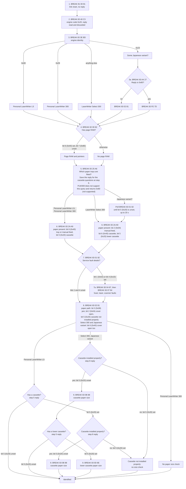

# Reverse Engineering the Personal LaserWriter 300 / LaserWriter Select 300 Driver

Write up of my learnings from decompiling the official Apple driver for these printers, and how to control them from modern machines.

From what I can tell of these drivers these printers are incredibly simple in that virtually all formatting and control is done from the host. The onboard logic requires the host to write to the printers RAM the current page to be printed, signal the page is ready and the printer then begins printing exactly what was handed to it with no real interpretation.

It can be thought of to be _kinda_ like the StyleWriter, but far more primitive in that the host is entirely in control and must fill in the onboard RAM and tell the printer when exactly to print.

The rough flow for driving it is:

- Switch the interface (on the host) to being externally clocked via HSKi. This is the only way
  to communicate with the printer, with my Personal 300 clocking it at roughly 530kHz.
- Send the link reset sequence and query the current status of the printer, and its engine/controller type. 
- Check for paper presence, and any errors that might be set (The Apple driver does not check for errors before printing attempts, but we can do better)
- If page RAM is reported (As on the Select 300 and LS models), probe the RAM to see how much is present. 
- Feed page data to it one page at a time, as one "packet" per scan line with the same RLE as a StyleWriter.
- After the current page has been fed in to RAM, send the print sequence
- Wait for the printer to signal it has finished that page and begin the next, if applicable.

## Data link

The printer constantly drives the HSKi line as long as it is powered up. This can be used to 
detect if the printer is currently connected and powered on. I have yet to find a case where
this clock stops.

The data link itself is clocked by the printer via HSKi as 8N1, LSB first. Transmits towards
the printer should be changed on the falling edge of this clock, and receives from the printer
should be sampled by us on the rising edge.

Every "packet" to the printer starts with a "BREAK" sequence, which is a logic 0 sent for a short period of time.  I assume this is for the onboard logic to "ready" for a command from us. When sampled with my Saleae my PowerBook G3 took approx 180uS, but I am not sure what the true minimum is required here. 

The Mac left a minimum of 210uS from the BREAK to the first bytes and 310uS between packets.

After the BREAK, the format then is a 1 byte command code, 1 arg byte for the command, and the XOR of those two bytes:
```
BREAK  cmd  arg  cmd^arg
``` 

The printer generally returns 1 byte from each command, with the notable exception being 0x8E -
if the printer responds with 0x00 and the printer does _not_ have page RAM, an additional
byte should be expected which contains the status byte.

The driver waits up to 5 seconds for a response to these before timing out. Note that for some commands like 0x82 I noticed the
printer would start answering us whilst we we are still transmitting the XOR byte, and for others like 0x83 it would take approx 30ms to respond.

If the response to a 0x83 command is 0x81 - 0xFF this should be considered an error with a request to immediately retry the command.
The original driver retries up to 4 times before giving up. 0x80 seems to be a special "not supported" response for some commands in the original driver

The printer can also send a BREAK sequence towards us, which is its way of signaling a sort of interrupt towards the 
host, where the host should then send 0x8E 0x00 towards it to read the status register. 

## Probe Sequence

The below sequence is the planned InkTalk identify-and-query sequence based on the original Apple driver. The Apple driver follows steps 1 through 4, with subsequent steps being ones I plan to have for InkTalk.

Note that I am very much guessing on what each "engine identity" resolves to based on how the original driver later handles them (Like the Select has multiple tray feeds, the one on the end has special B4 paper handling so I think it was some Japanese model, and such). The only confirmed one is 0x29 as a Personal LaserWriter 300 as I validated against it.



Notes:

- Bit 5 (0x20) on the response for command `83 25` reply means different things by printer. On
  the Personal LaserWriter LS it means the cassette (without it the printer has
  the multipurpose tray only), on the Select 300 and the Japanese variant it
  is the lower cassette.
- The driver checks paper size only for the cassette feeds. I dont believe there is a way to check
  the multipurpose cassettes (or at least I didnt see any).

## Status Regisgter (`8E 00`)
| Bit | Meaning |
| 0 | RAM full (as in the job tried to write beyond the onboard RAM) |
| 1 | Printer Error (Query the Engine status below if seen) |
| 2 | Page done (Success! Send the next page one if needed, otherwise done) |

## Engine status (`83 01`, `83 02`, `83 04`, `83 07`)

| Query | Bit | Meaning |
|---|---|---|
| `83 01` (all printers) | bit 1 (0x02) or bit 4 (0x10) | a fault is waiting to be read: send `83 04` and `83 07` to find which |
| | bit 4 (0x10) | if `83 04` and `83 07` show no fault, acknowledge with `83 5D` (inferred: "something to report") |
| | bit 5 (0x20) | Not ready yet(Japanese variant only). Driver waits up to 20 s for it to clear before checking for paper |
| `83 02` | bit 3 (0x08) | paper jam |
| | bit 2 (0x04) | front open, or toner cartridge not properly installed |
| | bit 5 (0x20) | cassette not installed properly |
| | bit 6 (0x40) | front open (Select 300 and Japanese variant only) |
| `83 04` | bit 6 (0x40) | fuser malfunction |
| | bit 5 (0x20) | laser malfunction |
| | bit 4 (0x10) | scanner motor malfunction |
| | bit 2 (0x04) | scanner motor malfunction (Japanese variant only) |
| `83 07` | bit 6 (0x40) | laser malfunction |
| | bit 3 (0x08) | cassette paper smaller than the page |